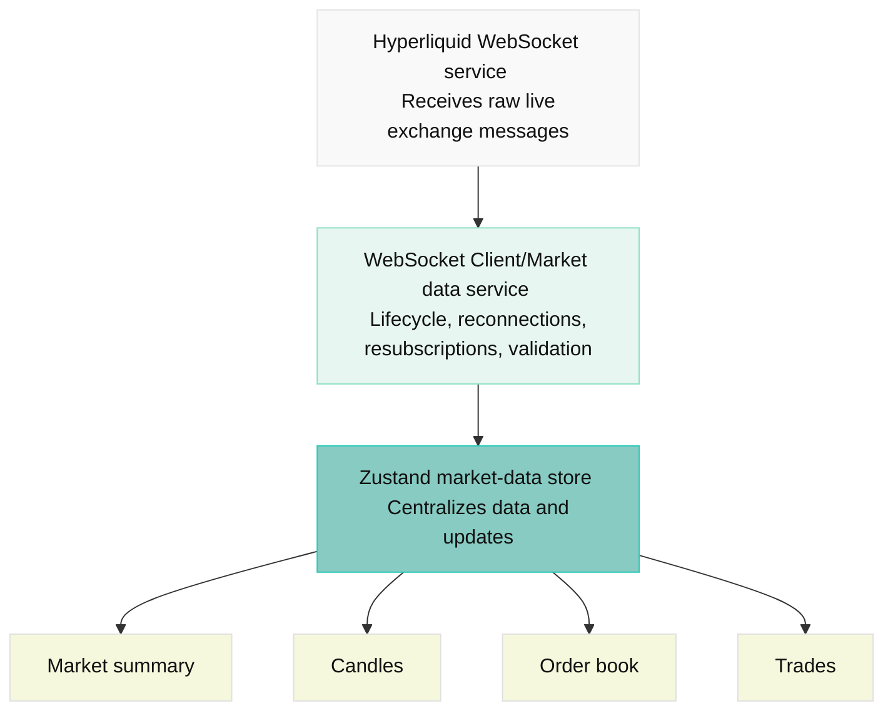

# Hyperliquid Market Overview

Frontend interface for the Hyperliquid testnet that displays live perpetuals market data.

# Stack

| Area         | Tools/Technology               | Reason                                                                  |
| ------------ | ------------------------------ | ----------------------------------------------------------------------- |
| Language     | TypeScript.                    | Catch malformed payloads and enforce consistent market-data models      |
| Build tool   | Vite                           | Minimal setup without server-side rendering overhead                    |
| UI           | React                          | Component-based interface and ecosystem                                 |
| Styling      | Tailwind CSS                   | Fast iteration on dense, responsive layouts                             |
| Icons        | Lucide React                   | Consistent, lightweight interface icons                                 |
| Client state | Zustand                        | Selected market, connection status, and user preferences                |
| Live data    | Native WebSocket API           | Direct control over subscription lifecycle and message processing       |
| Charts       | TradingView Lightweight Charts | Purpose-built financial charts without a heavyweight charting framework |
| Code quality | Biome                          | Formatting and linting with minimal tooling                             |

# Getting Started

To run this application:

```bash
npm install
npm run dev
```

# Building For Production

To build this application for production:

```bash
npm run build
```

## Styling

This project uses [Tailwind CSS](https://tailwindcss.com/) for styling.

## Linting & Formatting

This project uses [Biome](https://biomejs.dev/) for linting and formatting. The following scripts are available:

```bash
npm run lint
npm run format
npm run check
npm run check:fix
```

## Architecture



## Project Structure

| Directory                      | Responsibility                                                        |
| ------------------------------ | --------------------------------------------------------------------- |
| `src/app/`                     | Application shell, layout, providers, and environment configuration   |
| `src/app/store/`               | Market-data store                                                     |
| `src/features/market-summary/` | Market statistics                                                     |
| `src/features/order-book/`     | Order book store, selectors, cumulative depth calculations, and rows  |
| `src/features/trades/`         | Trade feed, retention policy, and tape components                     |
| `src/features/chart/`          | Candle data, chart adapter, and chart lifecycle                       |
| `src/services/hyperliquid/`    | WebSocket client, subscription manager, REST client, and API schemas  |
| `src/shared/`                  | Reusable UI components, formatting, numeric helpers, and common types |

## Next Steps

- **Validate market data with Zod:** Treat WebSocket messages and REST responses as untrusted input. Define schemas for incoming payloads and validate data at service boundaries before updating application state. Handle malformed or unexpected messages gracefully to protect the integrity of market data.

- **Strengthen WebSocket reconnection resilience:** Implement explicit connection states, retry strategies with exponential backoff, and automatic subscription restoration. Handle stale data and intermittent network failures gracefully to ensure the application recovers reliably without requiring a page reload.

- **Optimize real-time rendering performance:** Profile high-frequency order-book and trade updates to identify bottlenecks. Optimize state selectors, minimize unnecessary React re-renders, and batch UI updates where appropriate to maintain responsiveness under heavy market-data throughput.

- **Expand automated test coverage:** Add unit and integration tests for payload validation, subscription lifecycle, reconnection behavior, store updates, and market switching. Cover edge cases such as malformed messages, interrupted connections, duplicate subscriptions, and stale data to prevent regressions as the application evolves.

- **Introduce TanStack Query for server state:** Use TanStack Query to manage REST-based market data, including initial candle history and order-book snapshots where applicable. Leverage request caching, query invalidation, background refetching, and loading/error handling to complement the existing WebSocket-driven state.
