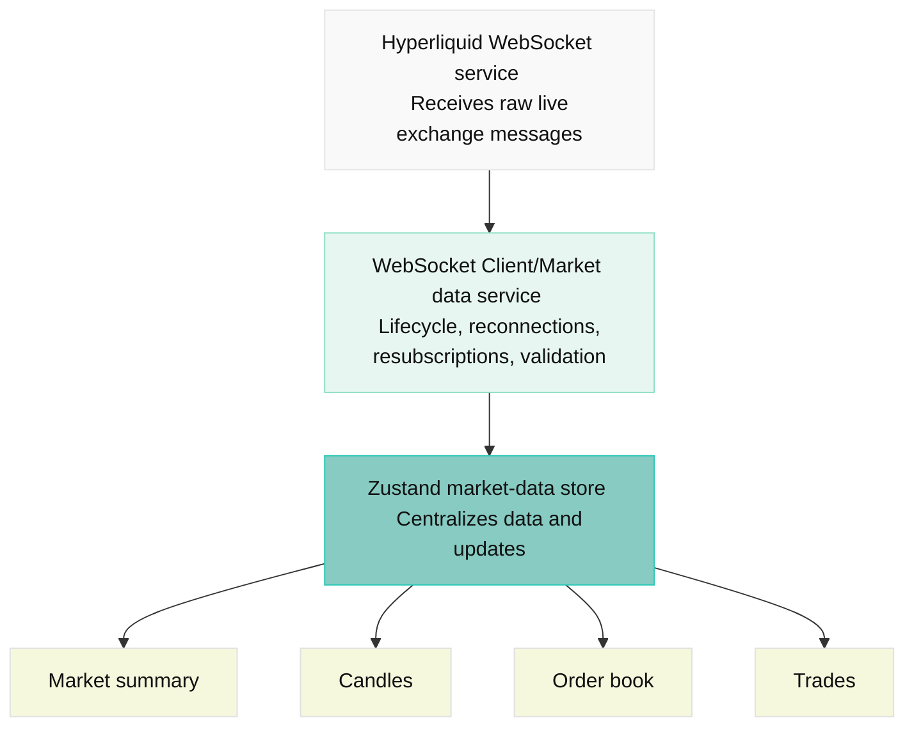

# Hyperliquid Market Overview

A real-time market dashboard for Hyperliquid testnet perpetuals, featuring BTC, ETH, and SOL market summaries, candlestick charts, a live order book with cumulative depth, and a recent trades feed.

Built with React, TypeScript, Vite, and Tailwind CSS, the project uses Zustand for market state, native WebSockets for live updates, and TradingView Lightweight Charts for visualization. Its scope includes market switching, automatic reconnection and resubscription, buffered order-book updates, and a high-traffic simulator for exploring rendering performance.

# Stack

| Area         | Tools/Technology               | Reason                                                                  |
| ------------ | ------------------------------ | ----------------------------------------------------------------------- |
| Language     | TypeScript.                    | Catch malformed payloads and enforce consistent market-data models      |
| Build tool   | Vite                           | Minimal setup without server-side rendering overhead                    |
| UI           | React                          | Component-based interface and ecosystem                                 |
| Styling      | Tailwind CSS                   | Fast iteration on dense, responsive layouts                             |
| Icons        | Lucide React                   | Consistent, lightweight interface icons                                 |
| Client state | Zustand                        | Selected market, connection status, and user preferences                |
| Live data    | Native WebSocket API           | Direct control over subscription lifecycle and message processing       |
| Charts       | TradingView Lightweight Charts | Purpose-built financial charts without a heavyweight charting framework |
| Code quality | Biome                          | Formatting and linting with minimal tooling                             |

# Getting Started

To run this application:

```bash
npm install
npm run dev
```

# Performance and Stress Testing

Use the **Simulate high traffic** switch to start or stop synthetic order-book updates immediately, without restarting the app. Simulation starts off. The selection is kept when switching markets and resets on page reload.

Enabling simulation starts:

- A 10ms simulator that generates ~100 synthetic updates/second for stress testing (increased/decreased via `src/app/store/market-data-controller` > `SIMULATOR_INTERVAL`)
- Both modes use a 50ms buffer that publishes the latest snapshot at most 20 times/second. (increased/decreased via `src/app/store/market-data-controller` > `ORDER_BOOK_PUBLISH_INTERVAL`)

# Building For Production

To build this application for production:

```bash
npm run build
```

## Styling

This project uses [Tailwind CSS](https://tailwindcss.com/) for styling.

## Linting & Formatting

This project uses [Biome](https://biomejs.dev/) for linting and formatting. The following scripts are available:

```bash
npm run lint
npm run format
npm run check
npm run check:fix
```

## Architecture



## Project Structure

| Directory                      | Responsibility                                                        |
| ------------------------------ | --------------------------------------------------------------------- |
| `src/app/`                     | Application shell, layout, providers, and environment configuration   |
| `src/app/store/`               | Market-data store                                                     |
| `src/features/market-summary/` | Market statistics                                                     |
| `src/features/order-book/`     | Order book store, selectors, cumulative depth calculations, and rows  |
| `src/features/trades/`         | Trade feed, retention policy, and tape components                     |
| `src/features/chart/`          | Candle data, chart adapter, and chart lifecycle                       |
| `src/services/hyperliquid/`    | WebSocket client, subscription manager, REST client, and API schemas  |
| `src/shared/`                  | Reusable UI components, formatting, numeric helpers, and common types |
